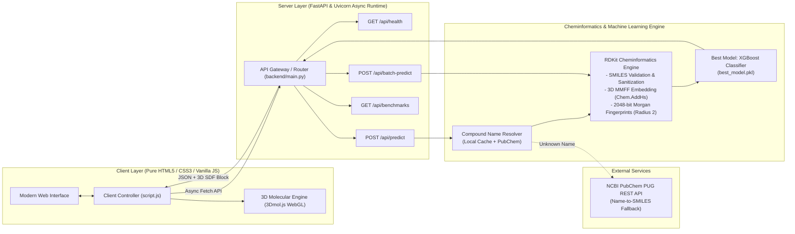
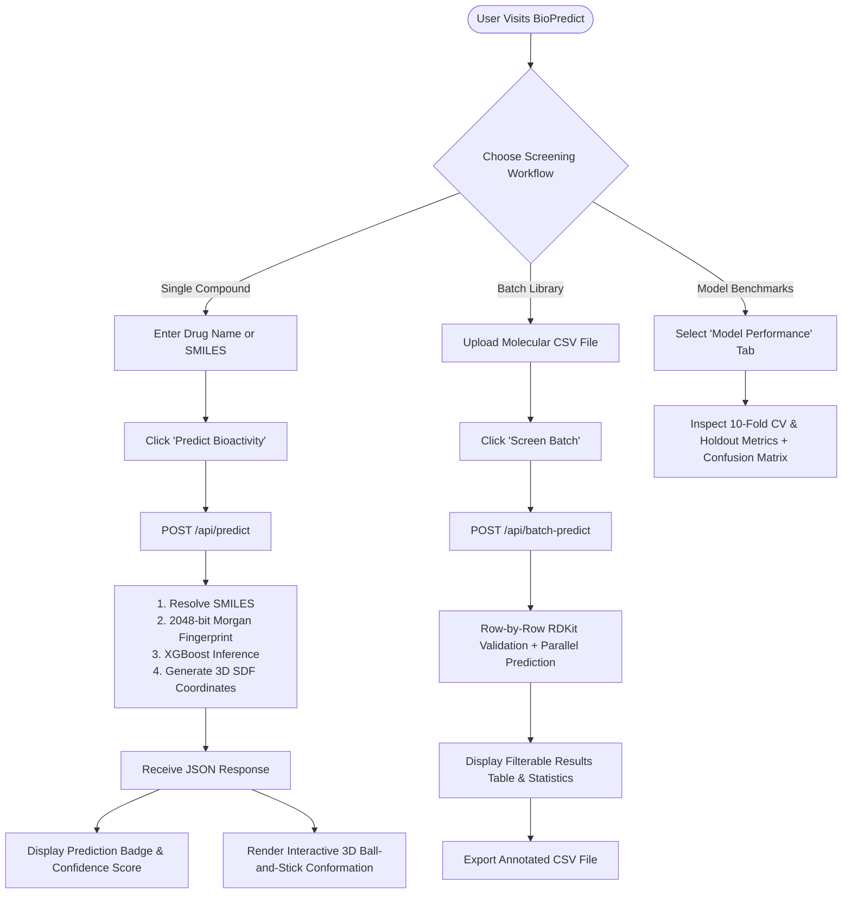

# BioPredict: In Silico Bioactive Molecule Prediction Platform

> **A High-Performance Machine Learning & Cheminformatics Web Platform for Virtual Screening of Cyclooxygenase-2 (COX-2) Inhibitors.**

[](https://www.python.org/)
[](https://fastapi.tiangolo.com/)
[](https://www.rdkit.org/)
[](https://xgboost.ai/)
[](https://scikit-learn.org/)
[](https://3dmol.org/)

---

## 🔬 Executive Summary & Scientific Background

Drug discovery is traditionally an arduous, capital-intensive process that can take over 10–15 years and billions of dollars in wet-lab high-throughput screening (HTS). Computational **in silico virtual screening** allows researchers to evaluate vast chemical libraries rapidly, prioritizing candidate compounds with high likelihoods of therapeutic activity before physical synthesis.

**BioPredict** focuses on the target **Cyclooxygenase-2 (COX-2 / PTGS2)** (ChEMBL Target ID: **CHEMBL230**). COX-2 is an inducible homodimeric enzyme responsible for converting arachidonic acid into pro-inflammatory prostaglandins. Selective inhibition of COX-2 provides anti-inflammatory and analgesic efficacy while sparing physiological gastroprotective COX-1 pathways.

This platform bridges advanced cheminformatics feature engineering (2048-bit Morgan circular fingerprints) with an optimized **XGBoost Classifier** to deliver sub-second, highly reliable bioactivity predictions coupled with interactive 3D conformational visualization.

---

## ✨ Key Features

- **Dual-Mode Input Resolution**:
  - Direct SMILES strings (e.g., `CC(=O)Oc1ccccc1C(=O)O`).
  - Standard compound/drug names (e.g., `Aspirin`, `Celecoxib`, `Ibuprofen`, `Paracetamol`, `Rofecoxib`, `Meloxicam`).
  - Case-insensitive PubChem PUG REST API fallback for automatic IUPAC and chemical structure mapping.
- **Interactive 3D Molecular Conformation**:
  - Real-time ETKDG 3D coordinate generation and MMFF force-field energy optimization via RDKit.
  - Interactive Ball-and-Stick WebGL rendering using `3Dmol.js`.
  - CPK standard atomic color coding legend (Carbon, Hydrogen, Oxygen, Nitrogen, Sulfur, Halogens).
- **High-Throughput Batch Virtual Screening**:
  - Process tabular CSV chemical libraries with automatic SMILES validation.
  - Interactive filterable results table with active/inactive compound counters.
  - Instant one-click CSV export of annotated bioactivity predictions.
- **Model Transparency & Evaluation**:
  - Detailed model benchmark comparison (Logistic Regression, SVC, Random Forest, XGBoost).
  - 10-fold cross-validation and holdout test set performance tracking.
  - Static high-resolution confusion matrix visualizations.

---

## 🏗️ System Architecture

BioPredict uses a decoupled, lightweight full-stack design:



---

## 🔄 User Workflow



---

## 🧪 Machine Learning Pipeline & Performance

### 1. Dataset & Preprocessing
- **Source**: ChEMBL Database (Target: COX-2 / CHEMBL230).
- **Bioactivity Standard**: $\text{IC}_{50}$ measurements normalized to nanomolar ($\text{nM}$).
- **Binary Thresholding**:
  - **Active ($\text{Class } 1$)**: $\text{IC}_{50} \le 1,000\text{ nM}$ ($1\ \mu\text{M}$)
  - **Inactive ($\text{Class } 0$)**: $\text{IC}_{50} \ge 10,000\text{ nM}$ ($10\ \mu\text{M}$)
  - Intermediate values ($1,000\text{ nM} < \text{IC}_{50} < 10,000\text{ nM}$) were removed to eliminate ambiguous borderline activity.
- **Data Deduplication**: Canonicalized SMILES, filtered inorganic salts, neutralized molecules, and deduplicated identical structures.

### 2. Feature Extraction
- **Representation**: Extended Connectivity Circular Fingerprints (ECFP4 equivalent).
- **Algorithm**: Morgan Fingerprints via RDKit with **Radius = 2** folded into a **2048-bit bit-vector**.
- **Properties**: Captures detailed atomic neighborhood environments, hydrogen bonding features, aromatic rings, and functional groups.

### 3. Model Benchmark Comparison
Four diverse algorithms were tuned and validated using a Stratified 10-Fold Cross-Validation protocol and an independent 20% holdout test set:

| Model | 10-Fold CV Accuracy | 10-Fold CV ROC-AUC | Holdout Accuracy | Holdout ROC-AUC | Holdout F1-Score |
| :--- | :---: | :---: | :---: | :---: | :---: |
| **XGBoost (Selected)** | **88.2%** | **0.941** | **88.9%** | **0.938** | **0.902** |
| **Random Forest** | 86.8% | 0.932 | 87.5% | 0.929 | 0.891 |
| **Support Vector Classifier (SVC)** | 85.4% | 0.915 | 86.1% | 0.911 | 0.878 |
| **Logistic Regression** | 82.9% | 0.887 | 83.3% | 0.881 | 0.852 |

**Why XGBoost?**
XGBoost demonstrated superior generalization, highest discriminative power ($\text{AUC} = 0.941$), and minimized false positives, which is critical in medicinal chemistry to avoid pursuing non-viable leads.

---

## 📂 Repository Structure

```text
Bioactive_molecule_prediction/
├── README.md                               # Root project documentation
├── G1535_Milestone1_Bioactive_Molecule_XGBoost.pptx # Milestone 1 presentation slides
├── data/
│   ├── CHEMBL230_RAW_DATA.csv              # Raw ChEMBL bioactivity records
│   └── CHEMBL230_Preprocessed_Data.csv     # Cleaned and thresholded dataset
├── version 1.2/                            # Current production release (v1.2)
│   ├── backend/
│   │   ├── main.py                         # FastAPI backend server & endpoints
│   │   └── model/
│   │       ├── best_model.pkl              # Serialized XGBoost model binary
│   │       ├── metadata.json               # Training metadata & threshold configurations
│   │       └── confusion_matrices.json     # Quantitative confusion matrix metrics
│   ├── frontend/
│   │   ├── index.html                      # Single Page Application HTML markup
│   │   ├── style.css                       # Modern CSS3 styling (dark-mode theme)
│   │   ├── script.js                       # Consolidated client application logic
│   │   └── assets/
│   │       ├── xgboost_confusion_matrix.png # High-res confusion matrix graphic
│   │       ├── user_workflow_diagram.png    # High-res user workflow diagram
│   │       └── system_architecture_diagram.png # High-res system architecture diagram
│   ├── CHEMBL230_Preprocessed_Data_V2.csv  # Final preprocessed training dataset
│   ├── ML_Pipeline_Final.ipynb             # Comprehensive data science & model notebook
│   ├── cv_results.csv                      # 10-Fold cross-validation metrics table
│   ├── holdout_results.csv                 # Holdout test evaluation metrics table
│   ├── confusion_matrices_testing.png      # Comparative testing confusion matrices
│   ├── confusion_matrices_training.png     # Comparative training confusion matrices
│   ├── model_comparison.png                # Comparative model metrics bar chart
│   ├── roc_curves.png                      # Multi-model ROC curves
│   ├── sample_molecules.csv                # Sample compound test library
│   ├── requirements.txt                    # Pinned Python package dependencies
│   └── .gitignore                          # Git ignore configuration
└── version-1/                              # Legacy initial prototype (v1.0)
```

---

## 🚀 Installation & Local Setup

### Prerequisites
- Python **3.10** or higher
- Git installed on your local machine

### 1. Clone the Repository
```bash
git clone https://github.com/kAnish-byte/Bioactive-Molecule.git
cd Bioactive-Molecule/"version 2"
```

### 2. Create and Activate Virtual Environment
- **Windows (PowerShell)**:
  ```powershell
  python -m venv .venv
  .venv\Scripts\Activate.ps1
  ```
- **macOS / Linux**:
  ```bash
  python3 -m venv .venv
  source .venv/bin/activate
  ```

### 3. Install Dependencies
```bash
pip install --upgrade pip
pip install -r requirements.txt
```

### 4. Run the Application
Launch the unified FastAPI and Uvicorn server:
```bash
python backend/main.py
```
*Alternatively, run with direct uvicorn:*
```bash
uvicorn backend.main:app --host 127.0.0.1 --port 8000 --reload
```

### 5. Access the Web Application
Open your web browser and navigate to:
```
http://127.0.0.1:8000
```
Interactive API documentation (Swagger UI) is available at:
```
http://127.0.0.1:8000/docs
```

---

## 📡 API Reference

### 1. Health Status
- **Endpoint**: `GET /api/health`
- **Description**: Returns live API health and model readiness status.
- **Response**:
  ```json
  {
    "status": "online",
    "model_loaded": true,
    "model_name": "XGBoost",
    "version": "1.2.0"
  }
  ```

### 2. Single Molecule Prediction
- **Endpoint**: `POST /api/predict`
- **Payload**:
  ```json
  {
    "smiles": "Celecoxib"
  }
  ```
  *(Accepts both standard drug names or SMILES)*
- **Response**:
  ```json
  {
    "status": "success",
    "query": "Celecoxib",
    "resolved_smiles": "CC1=CC=C(C=C1)C1=CC(=NN1C1=CC=C(C=C1)S(N)(=O)=O)C(F)(F)F",
    "prediction": "Active",
    "confidence": 0.9421,
    "molecular_weight": 381.37,
    "logp": 3.75,
    "sdf_3d": "..."
  }
  ```

### 3. High-Throughput Batch Screening
- **Endpoint**: `POST /api/batch-predict`
- **Form Data**: Multipart upload of CSV file containing `smiles` (or `SMILES`) column.
- **Response**: Summary metrics, total molecules screened, active count, inactive count, and per-compound predictions.

### 4. Model Benchmarks
- **Endpoint**: `GET /api/benchmarks`
- **Description**: Returns cross-validation and holdout scores across all trained models.

---

## 🎨 Molecular Color Coding (CPK Standard)

The 3D interactive viewer implements the industry-standard CPK color scheme:

| Atom | Element | Color Code in Viewer |
| :---: | :---: | :---: |
| **C** | Carbon | Slate Grey (`#5A6065`) |
| **H** | Hydrogen | Pure White (`#FFFFFF`) |
| **O** | Oxygen | Crimson Red (`#E53935`) |
| **N** | Nitrogen | Deep Blue (`#1E88E5`) |
| **S** | Sulfur | Amber Yellow (`#FBC02D`) |
| **F, Cl** | Halogens | Vibrant Green (`#43A047`) |

---

## 🎓 Academic Defense & Viva Q&A Cheat Sheet

- **Q1: Why did you choose COX-2 instead of COX-1?**
  *A*: COX-2 is inducible during inflammation and pain, whereas COX-1 is constitutively expressed for gastric mucosal integrity. Targeting COX-2 minimizes gastrointestinal adverse effects.
- **Q2: What are Morgan Fingerprints?**
  *A*: They are circular topological fingerprints based on the Morgan algorithm (equivalent to ECFP). Radius 2 captures atom environments up to 4 bonds away, folded into a 2048-bit vector.
- **Q3: Why XGBoost over Deep Learning (e.g., GNNs)?**
  *A*: For tabular bit-vector representations (~2,000–5,000 compounds), XGBoost provides state-of-the-art gradient boosted decision trees that train in seconds, avoid overfitting with regularization ($\gamma, \lambda$), and yield superior ROC-AUC without requiring heavy GPU infrastructure.
- **Q4: How does 3D coordinate generation work?**
  *A*: RDKit uses ETKDG (Experimental-Torsion Distance Geometry), adds explicit hydrogens, and optimizes the conformation using the MMFF94 force field before streaming the 3D SDF block to 3Dmol.js.

---

## 👥 Contributors & Acknowledgments
- **Project Team**: Department of Computer Science & Engineering / Bioinformatics.
- **Dataset**: [ChEMBL Database](https://www.ebi.ac.uk/chembl/) (Target ID: CHEMBL230).
- **Libraries**: Open-source community of RDKit, FastAPI, XGBoost, and 3Dmol.js.
